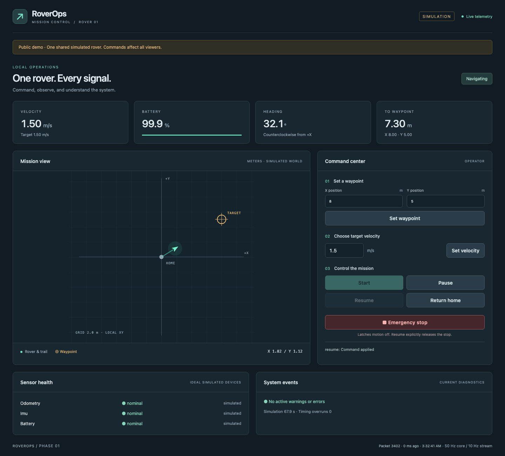
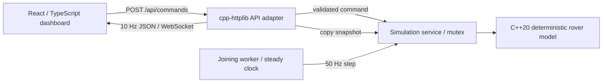

# RoverOps

**A C++20 autonomous-rover simulator with a live React operator console.**

[Open the live demo](https://roverops.onrender.com) ·
[CI results](https://github.com/adamxrodriguez/RoverOps/actions)

RoverOps demonstrates the boundary between robot state, concurrent execution,
network transport, and operator controls. A rover follows waypoints with bounded
acceleration and turning, consumes a simulated battery, and streams telemetry while
accepting commands. The implementation emphasizes inspectable ownership, explicit
state transitions, short critical sections, and tests that exercise a real process.

Phase 1 is a software simulator, runnable locally or as a shared public demo. It is not a hardware controller, validated
robotics safety system, ROS 2 node, or physics engine.



## Run locally

Requirements: a C++20 compiler and standard library with `std::jthread` support,
CMake 3.24+, a build tool, and Node.js 22.12+ with npm. Tested locally with Apple
Clang 17 / Xcode 26 on macOS. CI targets GCC and Clang on Ubuntu 24.04.

On macOS, install Xcode Command Line Tools (`xcode-select --install`) and CMake
(`brew install cmake`). On Ubuntu: `sudo apt-get install build-essential cmake`.
If CMake is not on your PATH, a project-local alternative is:

```sh
python3 -m venv .tools
.tools/bin/pip install cmake
```

From the repository root:

```sh
./scripts/build.sh
./build/roverops --config config/rover.json
```

In a second terminal, from the repository root:

```sh
cd dashboard
npm ci
npm run dev
```

Open **http://127.0.0.1:5173**. Set a waypoint (try X=8, Y=5), click **Start**, then
try **Pause**, **Resume**, **Emergency stop**, and **Return home**. **Set velocity**
changes the target; actual velocity changes gradually. Target velocity zero holds
motion after deceleration. Return home uses the current target velocity.

Stop each process with Ctrl+C. To use another API port:

```sh
./build/roverops --config config/rover.json --port 8081
# In dashboard/:
ROVEROPS_API_URL=http://127.0.0.1:8081 npm run dev
```

The C++ dependencies are checked in with licenses and fixed versions. The frontend
uses `package-lock.json` and `npm ci`; its first install needs npm registry access.
No cloud accounts, API keys, database, ROS installation, or dependency download is
needed for the C++ build. The build script finds a system CMake or `.tools/bin/cmake`.
For a production frontend bundle, run `npm run build` followed by `npm run preview`
in `dashboard/`; the local preview proxies the same API and WebSocket paths.

## Deploy a public demo

[Deploy to Render](https://render.com/deploy?repo=https://github.com/adamxrodriguez/RoverOps)
using the included `render.yaml`. It selects a **Free** Docker web service: the
C++ process serves the built dashboard, API, and WebSocket on one port. Render
provides HTTPS. No database or paid subscription is needed for a small demo.
Free services sleep after 15 minutes without inbound traffic and take about a
minute to wake up; usage quotas apply. See [Render's free service limits](https://render.com/docs/free).

The public demo has one shared rover, and every visitor can issue commands.
State resets on restart or sleep. See [deployment instructions](docs/DEPLOYMENT.md)
for Docker commands, settings, verification, and rollback.

## Architecture



```text
core/           Deterministic model, commands, state, dynamics
service/        Threaded simulation, configuration, JSON, HTTP/WebSocket, CLI
dashboard/      React console and process/browser acceptance tests
tests/          C++ domain, protocol, configuration, and concurrency tests
config/         Validated runtime settings
docs/           C++ learning guide, verification record, screenshots
scripts/        Build/test entry point
third_party/    Pinned C++ headers, licenses, and SHA-256 manifest
.github/        Build, test, sanitizer, and browser CI
```

### Why C++

The domain/runtime are written in C++ to make ownership, bounded updates, explicit
thread synchronization, and future native robotics integration first-class design
concerns. The model is independent of HTTP and React, so a future ROS 2 adapter can
reuse its tests. This does not claim hard real-time operation or benchmarked
performance. React handles the operator interface; it does not calculate rover state.

### Engineering decisions

- **One deterministic model.** `Rover::step(duration)` has no clock, network, or
  sleeping dependency. Tests advance synthetic time without waiting for a mission.
- **Small concrete layers.** No event bus, plugin framework, inheritance hierarchy,
  or speculative hardware interface. The adapter boundary is enough for Phase 1.
- **Explicit state machine.** Invalid transitions return typed results. A latched
  emergency stop rejects `start`, `return_home`, and waypoint changes. Only `resume`
  releases it. If an E-stop interrupted a paused mission, one resume releases into
  paused and a second resumes that mission. A zero battery requires a simulator restart.
- **Bounded kinematics.** Coordinates are meters; speed is m/s; heading is radians
  counterclockwise from +X. Acceleration, turning, braking, and arrival tolerance
  are configurable. Arrival stops within tolerance instead of snapping position.
- **Observable timing.** A steady clock schedules fixed simulation steps. Under
  overload, overdue steps are skipped rather than replayed in an unbounded burst;
  simulation time then lags wall time and `timing_overruns` increases. Unix timestamps
  are for display, not scheduling.
- **Mature transport.** [cpp-httplib](https://github.com/yhirose/cpp-httplib) provides
  HTTP and WebSocket framing. [nlohmann/json](https://github.com/nlohmann/json) handles
  JSON and [doctest](https://github.com/doctest/doctest) runs C++ tests. Application code
  does not implement a socket protocol.
- **Bounded local service.** Defaults allow four telemetry clients, with separate
  remaining HTTP worker capacity, a bounded request queue, 4 KiB input limits, and
  socket timeouts. Telemetry sends only the latest snapshot, with no growing backlog.

### Concurrency and ownership

`main` owns `Simulation` and `ApiServer` as local objects. `Simulation` owns its
`Rover`, mutex, and `std::jthread` by value. The API borrows the simulation by
reference and exclusively owns its HTTP server with `std::unique_ptr`. The server
owns HTTP workers and WebSocket sessions. No application object needs shared ownership.

One mutex serializes model steps, commands, and snapshot copies. A snapshot is an
owned value: serialization and network writes occur after unlocking. Commands are
applied synchronously under that lock; an HTTP success means the command was applied,
not just queued. Its returned state is a subsequent snapshot and can include another
concurrent command. There is no multi-command transaction or multi-operator arbitration.

Each WebSocket uses a library worker plus heartbeat thread. Its loop processes
control frames with a read timeout and publishes current telemetry at the configured
rate. A slow client may reduce its own cadence, while other clients and the model
continue. Scaling to a fleet would require revisiting this thread-per-connection design.

SIGINT/SIGTERM handlers only set a signal-safe flag. A normal watcher thread stops
the network server; HTTP and WebSocket handlers finish, then RAII joins the simulation
thread before its data is destroyed. See [the C++ guide](docs/CPP_GUIDE.md) for the
Java/JavaScript comparison, lifetime diagrams in prose, and interview exercises.

## API

By default the API binds to `127.0.0.1`. Vite proxies `/api` and `/ws` from the dashboard,
so no broad CORS policy is necessary. Browser origins must appear in
`server.allowed_origins`; non-browser clients such as curl can omit Origin.
The service has no authentication or built-in TLS. Origin checks are not authentication.
External binding requires explicit public-demo mode and an exact allowed browser
origin. Render terminates TLS in front of the container.

| Method / path | Behavior |
| --- | --- |
| `GET /api/health` | Readiness and schema version |
| `GET /api/config` | Public motion limits and update rates |
| `GET /api/state` | Latest complete telemetry snapshot |
| `POST /api/commands` | Validate and synchronously apply a command |
| `WS /ws/telemetry` | Server-to-client telemetry; commands use REST |

```sh
curl http://127.0.0.1:8080/api/state

curl -X POST http://127.0.0.1:8080/api/commands \
  -H 'Content-Type: application/json' \
  -d '{"command":"set_waypoint","x_m":8,"y_m":5}'

curl -X POST http://127.0.0.1:8080/api/commands \
  -H 'Content-Type: application/json' -d '{"command":"start"}'

curl -X POST http://127.0.0.1:8080/api/commands \
  -H 'Content-Type: application/json' \
  -d '{"command":"set_velocity","velocity_mps":1.5}'

curl -X POST http://127.0.0.1:8080/api/commands \
  -H 'Content-Type: application/json' -d '{"command":"emergency_stop"}'
```

Other command names are `pause`, `resume`, and `return_home`, with no extra fields.
Unknown keys are rejected to catch spelling mistakes. Success is
`{"ok":true,"message":"Command applied","state":{...}}`. Failure is
`{"ok":false,"error":{"code":"invalid_transition","message":"..."}}`.

| Status | Meaning |
| --- | --- |
| 400 | Malformed JSON, unknown command, missing/wrongly typed/extra fields |
| 403 | Browser origin denied |
| 409 | Command incompatible with current mode or depleted battery |
| 413 | Request exceeds the payload limit |
| 415 | Content-Type must be `application/json` |
| 422 | Non-finite or out-of-range command values |
| 503 | Shutdown in progress |

Telemetry includes `schema_version`, `sequence`, `timestamp_unix_ms`,
`simulation_time_s`, `timing_overruns`, `position`, `home`, `heading_rad`,
`velocity_mps`, `target_velocity_mps`, `battery_percent`, `mode`, nullable `waypoint`,
`sensors`, `warnings`, and `errors`. Each sensor includes health, a sample timestamp,
and `source: "simulated"`. Sequence numbers reset on process restart. Dashboard
telemetry older than two seconds disables mission controls and triggers a visible
stale/disconnected state; a dropped socket reconnects with bounded backoff.
Emergency stop remains clickable to attempt REST even when telemetry is unavailable.

## Configuration

Edit [config/rover.json](config/rover.json), then restart the simulator. Unknown keys,
wrong types, non-finite values, and invalid ranges fail startup with an error.

| Setting | Default | Accepted range / meaning |
| --- | --- | --- |
| `server.port` | 8080 | Integer 1–65535; CLI `--port` overrides |
| `server.host` | 127.0.0.1 | `0.0.0.0` requires public-demo mode |
| `server.public_demo` | false | Explicitly allows a shared, unauthenticated demo |
| `server.static_root` | empty | Optional directory containing the built dashboard |
| `server.tick_hz` | 50 | Integer 10–200 |
| `server.telemetry_hz` | 10 | Integer 1–30, no greater than tick rate |
| `server.max_websocket_clients` | 4 | Integer 1–8 |
| `server.allowed_origins` | localhost/127.0.0.1:5173 | Explicit dashboard browser origins |
| `max_velocity_mps` | 3 | 0.1–20 |
| `initial_target_velocity_mps` | 1 | 0–maximum velocity |
| `acceleration_mps2` | 0.8 | 0.01–10 |
| `max_turn_rate_radps` | 1.2 | 0.05–10 |
| `arrival_tolerance_m` | 0.15 | 0.01–5 |
| `world_limit_m` | 500 | 10–10000; waypoint input bound, not a collision boundary |
| `initial_battery_percent` | 100 | 0–100 |
| `low_battery_percent` | 20 | 0–100 |
| `idle_drain_percent_per_s` | 0.002 | 0–10 |
| `motion_drain_percent_per_m` | 0.006 | 0–10 |

Dynamics keys are under `dynamics`. Initial position/home is `(0,0)` and heading is
zero. Startup has no active waypoint or mission. Sensor fault simulation is future work.

## Verify and develop

```sh
./scripts/build.sh                       # Configure, compile, run C++ tests
# With system CMake, the equivalent is:
cmake -S . -B build -DCMAKE_BUILD_TYPE=Debug
cmake --build build --parallel 4
ctest --test-dir build --output-on-failure

cd dashboard
npm ci
npm run build                           # Strict TypeScript + production build
npm run test:api                        # Starts/stops its own real C++ process
npx playwright install chromium
npm run test:e2e                        # Starts C++ and Vite; requires port 5173 free
```

The C++ suite covers bounded movement, all-quadrant arrival, pause/resume, stop
latching, return home, invalid values, battery depletion, protocol validation,
snapshot isolation, concurrent clients, and lifetime shutdown. The API smoke test
adds real JSON requests, WebSocket packets, connection limits, reconnect, and
SIGTERM while clients remain connected. Browser tests exercise the controls,
mobile layout, disconnection, and reconnection against the actual backend.

Optional separate sanitizer builds, from the root:

```sh
BUILD_DIR=build-asan ./scripts/build.sh -DROVEROPS_SANITIZE=ON
cd dashboard
ROVEROPS_BINARY=build-asan/roverops npm run test:api
# From repository root, on a toolchain supporting ThreadSanitizer:
BUILD_DIR=build-tsan ./scripts/build.sh -DROVEROPS_TSAN=ON
```

Use `.clang-format` for first-party C++ and `.editorconfig` for general formatting.
Do not format vendored headers. CI is provided in `.github/workflows/ci.yml`;
[hosted results are on GitHub](https://github.com/adamxrodriguez/RoverOps/actions). Results are recorded
in [verification](docs/VERIFICATION.md).

## Limitations and next steps

- Kinematics use an ideal point rover on a flat plane. No wheel slip, traction,
  obstacle avoidance, localization uncertainty, terrain, or rigid-body physics.
- Pause/E-stop set simulated velocity to zero immediately. That is deliberately
  idealized and does not model actuator braking distance or a hardware interlock.
- Sensor status is ideal and simulated; battery discharge is a simple heuristic.
- No persistence, authentication, command audit database, rate limiting, mission
  queue, multiple rovers, or hard real-time scheduling. Restart resets the simulation.
- A browser connection loss does not stop an autonomous mission. Hardware integration
  needs a separately designed watchdog, actuator acknowledgment, and physical stop.
- Validation targets macOS/Linux. Windows and physical robotics hardware are untested.

Roadmap, continuing the same system:

1. **ROS 2 integration:** wrap state and commands in C++ nodes, messages, services,
   and lifecycle management while keeping the core tests transport-independent.
2. **Isaac Sim integration:** replace ideal kinematics with a simulator adapter and
   compare timestamped ground truth against telemetry.
3. **Sensor simulation:** noise, delay, stale samples, faults, and diagnostic policy.
4. **Path planning:** obstacle maps, intermediate waypoints, and replanning tests.
5. **Physical Jetson-based rover:** motor/sensor adapters, watchdogs, hardware E-stop,
   measured timing budgets, and staged bench testing.
6. **Cloud telemetry / fleet management:** authenticated transport, device identity,
   time-series storage, command authority, and multiple rovers.

Demo placeholders: add a narrated walkthrough of one mission and an architecture
explanation here; add a physical rover clip only after hardware validation.
The included screenshot is from the running Phase 1 application, not a mockup.
